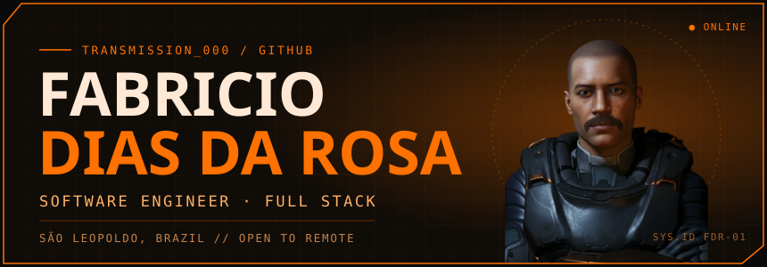
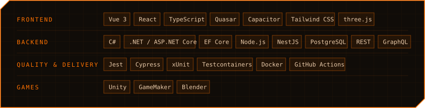
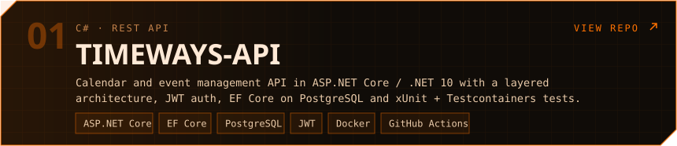
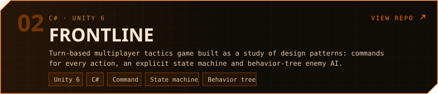
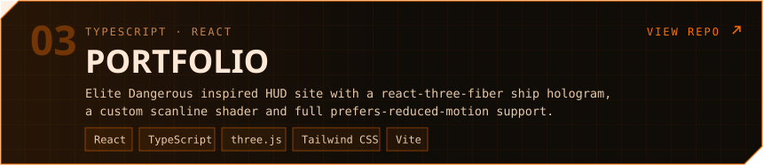
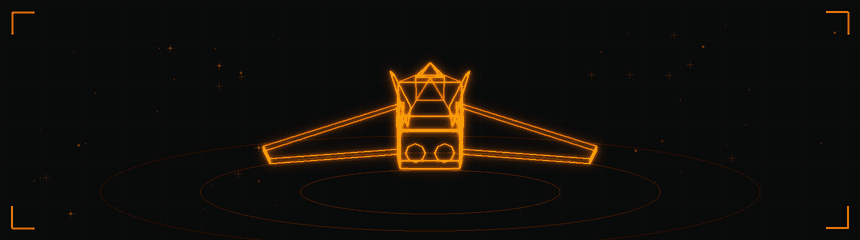

  &nbsp;
  &nbsp;
  

Full stack software engineer working with **Vue 3, React and TypeScript** on the front end and **C# / .NET, Node.js and NestJS** on the back end. I care about interfaces that feel good to use and architecture that keeps them easy to change.

- At **Minha Visita** I went from support to the core engineering team in two months, then shipped web and hybrid mobile features with Vue, Quasar and Capacitor, built an Outlook-style recurrence scheduling engine in three languages, and covered it all with Cypress and Jest in CI.
- Before that I taught programming and game development to **40+ students**.
- Off the clock I build small games in Unity with my own Blender models.

Open to **full stack, front-end or back-end roles**, remote or with relocation.

